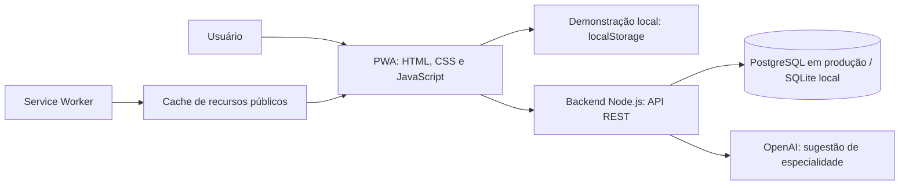

# Agendaê — Saúde na Palma da Mão

PWA acadêmica do Projeto Integrador do SENAC para simplificar o agendamento de consultas. O usuário pode organizar sua agenda, acessar uma conta e receber uma sugestão inicial de especialidade a partir dos sintomas relatados.

**Site:** [agendae-pwa.vercel.app](https://agendae-pwa.vercel.app) · **Repositório:** [eusettee/agendae-pwa](https://github.com/eusettee/agendae-pwa)

> Unidades, profissionais e horários são fictícios. Nenhuma consulta real é marcada. Use dados fictícios na apresentação. A pré-triagem não faz diagnóstico, não prescreve e não substitui avaliação médica.

## Índice

- [Estado da entrega](#estado-da-entrega)
- [Funcionalidades e fluxos](#funcionalidades-e-fluxos)
- [Executar localmente](#executar-localmente)
- [Arquitetura e tecnologias](#arquitetura-e-tecnologias)
- [Banco e modelo de dados](#banco-e-modelo-de-dados)
- [Login e proteção dos dados](#login-e-proteção-dos-dados)
- [Pré-triagem com IA](#pré-triagem-com-ia)
- [API REST](#api-rest)
- [PWA, instalação e offline](#pwa-instalação-e-offline)
- [Testes e validação](#testes-e-validação)
- [Configurar a produção](#configurar-a-produção)
- [Commits e deploy automático](#commits-e-deploy-automático)
- [Roteiro de apresentação](#roteiro-de-apresentação)
- [Solução de problemas](#solução-de-problemas)
- [Próximas etapas](#próximas-etapas)

## Estado da entrega

| Recurso | Implementação | Condição para usar |
| --- | --- | --- |
| Interface responsiva e navegação | Implementado | Navegador com JavaScript |
| CRUD de consultas de demonstração | Implementado e testado | Disponível sem login; dados locais |
| Cadastro, login e logout | Implementado e testado localmente | PostgreSQL configurado na Vercel para produção |
| CRUD de consultas da conta | Implementado e testado localmente | Login e banco conectado |
| Disponibilidade compartilhada | Implementada | Banco impede duplicidade entre contas |
| Pré-triagem com OpenAI | Integração preparada e testada com respostas simuladas | Banco, login e chave OpenAI |
| Manifest, Service Worker e cache | Implementados e testados | Primeiro acesso online em HTTPS ou localhost |
| Elegibilidade para instalação | Confirmada pelo Chrome | Instalação efetiva depende do navegador/plataforma |
| Publicação e integração GitHub–Vercel | Configuradas | Push na branch `main` dispara deploy |

Na última verificação em **05/10/2026**, o site estava publicado e `/api/status` informava `accounts: false` e `ai: false`: as variáveis do banco e da OpenAI ainda não estavam configuradas. A demonstração local permanecia disponível. Esse registro descreve aquela verificação; consulte o endpoint para conhecer a configuração atual. Ele indica presença de configuração, não garante conectividade com os provedores.

A IA foi deixada preparada, sem ativação de chamadas reais. A criação do Neon gratuito exige o aceite dos termos do provedor na conta Vercel antes de prosseguir.

## Funcionalidades e fluxos

### Agendamento

1. Escolher especialidade: Clínica Geral, Ortopedia, Dermatologia, Cardiologia ou Pediatria.
2. Escolher uma das três unidades fictícias de Recife.
3. Selecionar o profissional vinculado à unidade e à especialidade.
4. Escolher data futura, de segunda a sexta, e horário disponível.
5. Confirmar o armazenamento e salvar.
6. Em **Consultas**, listar, editar/reagendar ou cancelar.

A aplicação oferece seis profissionais e horários fixos de demonstração. Alterar uma consulta mantém seu identificador; cancelar a remove e libera o horário. Agendamentos em datas passadas e combinações inválidas de unidade/profissional são rejeitados.

### Dois modos de uso

| Característica | Demonstração sem login | Conta autenticada |
| --- | --- | --- |
| Persistência | `localStorage` deste navegador | Banco acessado pelo backend |
| CRUD | Criar, listar, editar e cancelar | Criar, listar, editar e cancelar |
| Funcionamento offline | Sim, após preparação do cache | Alterações e carregamento exigem internet |
| Conflitos de horário | Verificados neste navegador | Restrição no banco entre contas |
| Pré-triagem com IA | Escolha manual de especialidade | IA quando a chave estiver configurada |
| Acesso em outro dispositivo | Não compartilha dados | Login na mesma conta |

Não existe importação ou sincronização automática entre os modos. Dados da conta não são gravados no armazenamento local. Apagar os dados da demonstração em **Ajuda** não exclui a conta nem suas consultas no servidor.

## Executar localmente

Requisitos: **Node.js 24.x**, npm e um navegador atual. O Google Chrome instalado é necessário para os testes de navegador.

```sh
git clone https://github.com/eusettee/agendae-pwa.git
cd agendae-pwa
npm ci
npm start
```

O repositório é privado: o clone exige acesso à conta GitHub autorizada. Se já tiver os arquivos, execute os dois últimos comandos na pasta do projeto.

Abra **http://localhost:3000**. Não abra `index.html` diretamente: o Service Worker precisa de HTTPS ou localhost.

Sem variáveis de banco, o ambiente local cria SQLite em `data/agendae.sqlite` no primeiro uso. Você pode cadastrar uma conta e testar o CRUD sem serviços externos. `data/` é ignorada pelo Git. Essa alternativa não é usada na Vercel, onde arquivos locais não oferecem a persistência necessária.

Para usar PostgreSQL e/ou OpenAI localmente, copie `.env.example` para `.env.local`:

```powershell
Copy-Item -LiteralPath .env.example -Destination .env.local
```

Preencha os valores e reinicie `npm start`. O comando carrega esse arquivo automaticamente. Nunca publique chaves, conexões ou dados do banco.

| Variável | Uso | Padrão/alternativa |
| --- | --- | --- |
| `DATABASE_URL` | Conexão PostgreSQL pooled fornecida pelo provedor | Preferida em produção |
| `POSTGRES_URL` | Alternativa para a conexão PostgreSQL | Usada se `DATABASE_URL` não existir |
| `OPENAI_API_KEY` | Chave privada da OpenAI no backend | Sem chave, oferece escolha manual |
| `OPENAI_MODEL` | Modelo compatível com a saída estruturada utilizada | `gpt-4.1-mini` |
| `PORT` | Porta do servidor local | `3000` |
| `SQLITE_PATH` | Caminho alternativo do SQLite local | `data/agendae.sqlite` |

## Arquitetura e tecnologias



O navegador acessa o banco e a OpenAI somente pela API. As chaves permanecem no servidor.

| Camada | Tecnologia | Responsabilidade |
| --- | --- | --- |
| Frontend | HTML semântico, CSS e JavaScript sem framework | Navegação, formulários e interface responsiva |
| Backend | Node.js, funções serverless Vercel | Sessões, validação, persistência e pré-triagem |
| Banco de produção | PostgreSQL via `pg` | Usuários, sessões, consultas e limites de requisições |
| Banco local | `node:sqlite` | Desenvolvimento e testes sem banco remoto |
| IA | Responses API da OpenAI | Sugestão de especialidade com JSON estruturado |
| PWA | Manifest e Service Worker | Instalação e cache offline |
| Testes | `node:test` e Playwright | Regras, API, navegador e offline |

### Organização do projeto

```text
agendae-pwa/
├── api/                     Rotas serverless
│   ├── appointments.js      CRUD de consultas da conta
│   ├── auth.js              Cadastro, login, sessão e logout
│   ├── availability.js      Horários ocupados
│   ├── catalog.js           Unidades, especialidades e profissionais
│   ├── status.js            Presença de configuração de banco e IA
│   └── triage.js            Pré-triagem autenticada
├── lib/                     Regras e serviços do backend
│   ├── appointment.cjs      Validação de consultas
│   ├── auth.cjs             Senhas, sessões e limites
│   ├── catalog.cjs          Dados fictícios do catálogo
│   ├── database.cjs         Adapter PostgreSQL/SQLite
│   ├── http.cjs             Respostas e proteção de origem
│   └── triage.cjs           Validação e chamada OpenAI
├── migrations/              Esquema SQL versionado
├── public/
│   ├── css/style.css
│   ├── js/                  Interface, conta e catálogo offline
│   ├── icons/               Ícones PNG 192/512 e maskable
│   ├── index.html
│   ├── manifest.json
│   └── sw.js
├── tests/                   Testes de API, regras e navegador
├── artifacts/               Capturas da interface
├── tools/                   Geração de ícones e catálogo offline
├── .env.example             Nomes das variáveis, sem segredos
├── publicar.ps1             Publicação pelo PowerShell
├── server.cjs               Servidor de desenvolvimento
└── vercel.json              Saída pública, funções e headers
```

Para alterar o catálogo, edite `lib/catalog.cjs` e execute:

```sh
node tools/generate-assets.cjs
```

Isso atualiza sua cópia offline e gera os ícones. Ao mudar recursos cacheados, atualize a versão do cache no Service Worker e as versões dos arquivos no HTML para os navegadores receberem a atualização.

## Banco e modelo de dados

O esquema está em `migrations/001-initial.sql`. As tabelas são criadas automaticamente no primeiro acesso ao banco. O arquivo define o esquema inicial; futuras alterações precisarão de novas migrações.

| Tabela | Dados principais | Finalidade |
| --- | --- | --- |
| `users` | ID, nome, e-mail único, hash da senha e criação | Contas de pacientes |
| `sessions` | Hash do token, usuário e expiração | Autenticação revogável por logout |
| `appointments` | Usuário, paciente, unidade, profissional, data e hora | Consultas da conta |
| `request_limits` | Identificador, contador e expiração | Limites de login/cadastro e IA |

Usuários possuem várias sessões e consultas. As consultas têm restrição `UNIQUE (professional_id, date, time)`, que impede duas reservas para o mesmo profissional e horário. Os dados do catálogo são estáticos nesta etapa; não existem tabelas ou painel para administrá-los.

## Login e proteção dos dados

- Cadastro com nome entre 2 e 80 caracteres, e-mail e senha entre 8 e 128 caracteres, mediante consentimento.
- E-mail normalizado e único; senha derivada com scrypt e salt aleatório.
- Sessão com token aleatório; o banco armazena o hash do token.
- Expiração de sete dias; logout invalida a sessão utilizada.
- Cookie `HttpOnly`, `SameSite=Lax`, com `Secure` em produção.
- Consultas vinculadas ao usuário autenticado; IDs de consultas de outra conta não permitem leitura ou alteração.
- Consultas SQL parametrizadas e validação de entrada no backend.
- Escritas exigem JSON e rejeitam origem cruzada conforme as verificações do servidor.
- Login/cadastro: até 30 tentativas por IP e 10 por e-mail em janelas fixas de 15 minutos.
- Respostas da API usam `Cache-Control: no-store` e são excluídas do cache do Service Worker.

A implementação usa sessões armazenadas no banco, em vez de JWT. Ainda não há recuperação de senha, verificação de e-mail, exclusão de conta ou perfis administrativos. Esta etapa não representa uma solução pronta para uso clínico ou uma certificação de conformidade com a LGPD.

## Pré-triagem com IA

O papel da IA é **guiar o usuário para a especialidade adequada à queixa**, com limites claros:

```text
Sintomas + duração + intensidade + consentimento
                       ↓
             Validação no backend
                       ↓
      Sugestão inicial de especialidade
                       ↓
     Usuário confirma ou escolhe manualmente
                       ↓
        Profissional → data → agendamento
```

A pré-triagem exige login e internet. O formulário aceita relatos de 10 a 1000 caracteres. O backend envia somente sintomas, duração e intensidade; não acrescenta nome, e-mail ou dados da sessão. O relato não é salvo na agenda ou no banco.

A resposta da OpenAI deve seguir um JSON Schema estrito e conter apenas especialidade permitida, confiança e possível urgência. O backend valida a resposta antes de usá-la. A confiança é um campo produzido pelo modelo e não uma probabilidade clínica validada.

| Situação | Comportamento |
| --- | --- |
| Sugestão válida | Mostra a especialidade e permite aplicá-la ao agendamento |
| Informações insuficientes/baixa confiança | Oferece Clínica Geral, com possibilidade de escolha manual |
| Possível urgência | Mostra orientação para buscar atendimento de urgência e contato 192 |
| Sem chave, timeout, recusa ou resposta inválida | Informa indisponibilidade e oferece escolha manual |
| Mais de cinco solicitações por conta na janela de uma hora | Retorna limite de requisições |

A chamada tem timeout de 15 segundos e saída limitada a 300 tokens. Existe uma verificação conservadora de alguns termos de urgência antes de chamar a IA; ela pode gerar falsos alertas e não cobre todas as emergências. A ausência de um alerta nunca garante que seja seguro aguardar.

A integração utiliza `store: false`, que desativa armazenamento da resposta para recuperação pela API; isso não equivale a uma garantia de retenção zero pelo provedor. A integração real ainda precisa ser testada com chave válida e os resultados precisam de avaliação por profissionais.

Referência: [saída estruturada na documentação oficial da OpenAI](https://developers.openai.com/api/docs/guides/structured-outputs?api-mode=responses).

## API REST

Base: `/api`. Entradas e respostas em JSON. Rotas privadas autenticam pelo cookie de sessão; não utilizam token JWT no navegador.

| Método | Rota | Acesso | Resultado |
| --- | --- | --- | --- |
| GET | `/catalog` | Público | Catálogo fictício |
| GET | `/status` | Público | Presença de configuração de banco e IA |
| GET | `/auth` | Público/sessão | Usuário da sessão ou `null` |
| POST | `/auth` | Conforme ação | `register`, `login` ou `logout` |
| GET | `/appointments` | Login | Consultas do usuário |
| POST | `/appointments` | Login | Cria consulta |
| PUT | `/appointments` | Login | Atualiza consulta pelo ID no corpo |
| DELETE | `/appointments` | Login | Remove consulta pelo ID no corpo |
| GET | `/availability?professionalId=ana&date=2099-10-05` | Login | Horários ocupados do profissional |
| POST | `/triage` | Login | Orientação inicial ou alternativa manual |

Exemplo de cadastro com dados fictícios:

```json
{
  "action": "register",
  "name": "Paciente Demo",
  "email": "paciente@example.test",
  "password": "use-uma-senha-propria",
  "consent": true
}
```

Exemplo de consulta enviada para `POST /api/appointments`:

```json
{
  "clinicId": "boa-vista",
  "professionalId": "ana",
  "date": "2099-10-05",
  "time": "09:00"
}
```

O nome do paciente vem da conta, e o servidor cria o ID. Para editar, envie os mesmos campos e `id` por PUT. Para excluir, envie `{ "id": "ID_DA_CONSULTA" }` por DELETE. As datas dos exemplos são apenas ilustrativas: use uma data futura válida.

Exemplo de pré-triagem:

```json
{
  "symptoms": "Relato fictício de dor persistente no joelho ao caminhar",
  "duration": "há dois dias",
  "intensity": "leve",
  "consent": true
}
```

Códigos principais: `200` sucesso, `201` criação, `401` sessão ausente/inválida, `403` origem rejeitada, `404` consulta inexistente ou inacessível, `405` método não permitido, `409` conflito, `415` formato incorreto, `422` validação, `429` limite e `503` serviço indisponível. Erros retornam `{ "error": "mensagem" }`.

## PWA, instalação e offline

O manifest configura nome, nome curto, cores, idioma, `start_url`, escopo, modo `standalone` e ícones de 192/512 pixels, incluindo uma versão maskable.

O Service Worker precacheia HTML, CSS, JavaScript, catálogo, manifest e ícones. A navegação tenta a rede e usa o HTML armazenado quando estiver offline. Recursos essenciais usam cache; chamadas `/api/` e métodos de escrita não são interceptados. Versões antigas do cache da aplicação são removidas na ativação.

Para demonstrar offline:

1. Acesse online e espere **Modo offline pronto** em Ajuda.
2. Use a demonstração sem login e salve uma consulta fictícia.
3. DevTools → Network → Offline.
4. Recarregue a página e abra Consultas.
5. Edite, cancele ou crie outra consulta de demonstração.
6. Reative a rede ao terminar.

Para instalar, use **Instalar app** quando oferecido pelo Chrome/Edge. No iPhone, abra no Safari e escolha Compartilhar → Adicionar à Tela de Início. A elegibilidade foi validada em Chrome com perfil normal; o teste não instalou o app na interface do sistema.

## Testes e validação

```sh
npm ci
npm test
npm run test:e2e
```

| Suíte | Verificações |
| --- | --- |
| Regras e API | Datas, vínculos, autenticação, CRUD, conflitos, isolamento e logout |
| Pré-triagem | Consentimento, alertas, entrada mínima, resposta estruturada, falhas e recusa |
| Navegador | Cadastro/login, CRUD, persistência, edição offline, manifest, cache e layouts |
| Instalação | Elegibilidade da PWA no Chrome fora do modo anônimo |

Na última validação funcional, passaram **5 testes de regras/API/IA e 4 testes de navegador**. Os testes de persistência usam SQLite local; não representam teste de conexão com PostgreSQL remoto. As respostas da OpenAI são simuladas; não comprovam funcionamento com uma chave real ou adequação clínica.

O Playwright usa Chrome instalado e a porta 3000. Ele reutiliza um servidor existente; confirme que esse servidor executa a versão atual do projeto. As capturas ficam em `artifacts/`, e os relatórios temporários são ignorados pelo Git.

## Configurar a produção

### Banco PostgreSQL

1. Na Vercel, abra `agendae-pwa` → Storage → Create Database.
2. Escolha Neon gratuito ou conecte um banco Supabase existente.
3. Aceite os termos do provedor quando solicitado. Para a tentativa Neon pela CLI, a Vercel indicou [este endereço de aceite](https://vercel.com/eusettees-projects/~/integrations/accept-terms/neon?source=cli).
4. Conecte o recurso ao projeto e ao ambiente Production.
5. Confirme `DATABASE_URL` ou `POSTGRES_URL` em Settings → Environment Variables, usando a conexão pooled com TLS indicada pelo provedor.
6. Faça novo deploy e teste cadastro/login. As tabelas são criadas no primeiro uso.

A integração pode preencher outras variáveis; esta aplicação utiliza as duas opções de URL acima. Não configure caminhos SQLite na produção Vercel.

### OpenAI — ativação opcional

1. Configure `OPENAI_API_KEY` como segredo em Production.
2. Opcionalmente, defina `OPENAI_MODEL` com um modelo compatível com o contrato utilizado.
3. Faça novo deploy.
4. Entre em uma conta e teste a pré-triagem com relato fictício.

As chamadas dependem do acesso e da disponibilidade da API na conta OpenAI. Enquanto a chave não estiver configurada, a aplicação deve informar a alternativa manual.

Referências: [configuração Vercel](https://vercel.com/docs/project-configuration/vercel-json) e [armazenamento pelo Marketplace](https://vercel.com/docs/marketplace-storage).

## Commits e deploy automático

**O GitHub armazena os commits. A Vercel cria deployments a partir deles.** O projeto está conectado ao repositório `eusettee/agendae-pwa`, com produção na branch `main`.

Para publicar uma alteração revisada:

```sh
git add README.md
git commit -m "docs: atualiza documentacao do projeto"
git push origin main
```

O push dispara a publicação automática na Vercel. Confira o deployment em **Ready** e se o SHA corresponde ao commit enviado antes de considerar a publicação concluída. Mudanças apenas nas variáveis de ambiente também exigem novo deploy.

Para configurar/publicar pela CLI, o projeto inclui:

```powershell
.\publicar.ps1
```

O script solicita login quando necessário, cria o repositório privado se não houver remoto, faz commit das alterações, envia ao GitHub, vincula o projeto Vercel e publica em produção. Também conecta a integração Git e aceita a situação em que o repositório já esteja conectado. Requer Git, GitHub CLI, Node.js/npm e permissões nas duas contas.

Arquivos de ambiente reais, banco SQLite, dependências, perfil de testes e configuração local Vercel são ignorados pelo Git. O ZIP de entrega não contém esses arquivos. O histórico versiona apenas o exemplo de nomes das variáveis, sem valores secretos.

Referência: [integração Git da Vercel](https://vercel.com/docs/cli/git).

## Roteiro de apresentação

1. **Proposta:** reduzir etapas para organizar consultas e orientar a escolha de especialidade.
2. **Telas:** mostrar Início, Agendar, Consultas, Triagem, Conta e Ajuda; adaptar para celular.
3. **CRUD:** criar uma consulta fictícia, listar, editar o horário e cancelar.
4. **PWA:** mostrar nome, ícones, cores e `standalone` no manifest.
5. **Cache:** explicar os recursos de `sw.js` e a exclusão das rotas de API.
6. **Offline:** recarregar e executar o CRUD da demonstração sem internet.
7. **Instalação:** instalar se o navegador oferecer o recurso.
8. **Conta:** com banco configurado, cadastrar/entrar e mostrar persistência e isolamento.
9. **IA:** com chave configurada, mostrar sugestão de especialidade e sua aplicação ao formulário; sem chave, demonstrar a alternativa manual e declarar a pendência.
10. **Evolução:** explicar validação clínica, perfis administrativos e integração com clínicas.

## Solução de problemas

| Sintoma | Verificação/ação |
| --- | --- |
| `EADDRINUSE` na porta 3000 | Encerre o servidor anterior deste projeto e reinicie |
| Login em configuração | Configure o PostgreSQL, conecte ao projeto e faça novo deploy |
| Variáveis salvas, mas recurso ainda inativo | Confira ambiente Production e gere um deployment novo |
| Banco indisponível | Verifique URL pooled, TLS, disponibilidade e credenciais no provedor |
| IA oferece escolha manual | Confira chave, acesso ao modelo e disponibilidade; sem chave esse comportamento é esperado |
| Muitas tentativas | Aguarde a janela de limite expirar |
| Horário ocupado | Escolha outro ou cancele a reserva anterior; o banco verifica conflitos |
| Offline não carrega | Faça primeiro acesso em localhost/HTTPS e espere o cache ficar pronto |
| Instalação não aparece | Use navegador compatível com perfil normal; modo anônimo pode impedir |
| Interface antiga após atualização | Reconecte à internet e recarregue; confira atualização do Service Worker |
| Dados ausentes em outro dispositivo | A demonstração é local; para compartilhar consultas use uma conta |
| Teste e2e falha por servidor antigo | Reinicie o servidor local antes da suíte |

## Próximas etapas

- Ativar e validar banco PostgreSQL e, quando solicitado, a chave OpenAI na produção.
- Validar a pré-triagem e o comportamento de urgência com profissionais de saúde.
- Recuperação de senha, verificação de e-mail e gestão/exclusão de conta.
- Perfis de administrador e profissional, com CRUD de clínicas, especialidades e disponibilidade.
- Integração com clínicas reais, auditoria, consentimentos e política de retenção.
- Testes de usabilidade, acessibilidade e uso por pessoas idosas.
- App React Native, lembretes e outras funções previstas nas etapas posteriores.

## Contexto acadêmico

Projeto Integrador do SENAC, baseado nos documentos **Saúde na Palma da Mão** e **Agendaê — Documentação do Projeto**, e no checklist de entrega PWA fornecido. A primeira versão priorizou a aplicação funcional, telas essenciais, responsividade, interação, manifest, cache, offline e instalação. Solicitações posteriores ampliaram o escopo para login, persistência e pré-triagem preparada com IA.

Os documentos não são distribuídos neste repositório. Requisitos mais amplos ainda não implementados estão identificados nas seções de limitações e próximos passos.
