# Agendaê — Saúde na Palma da Mão (React Native)

Versão em **React Native com Expo** do PWA *Agendaê*. Projeto Integrador — Faculdade Senac Pernambuco, ADS, turma **32.109**.

**Proposta (B2G):** um atendimento de saúde para o cidadão pelo **WhatsApp do Conecta Recife**, pensado para quem tem pouco acesso à internet. A pessoa faz a **pré-triagem em casa**, escolhe o **hospital de destino**, e a ficha segue pelo SUS. Ao chegar, ela informa o CPF ou o protocolo: **o médico já conhece o caso e a etapa de triagem no hospital é eliminada.**

> Demonstração acadêmica com dados fictícios. A consulta ao cadastro SUS e o envio ao DataSUS são **simulados**. A orientação não é diagnóstico. Em emergência, ligue 192.

## Integrantes

Caio Esdras · Heitor Sette · Cristiano Alves · Pedro Luiz · James Bernardino · Alysson Rodrigo

## Como executar

Requisitos: Node.js 20 ou superior e o app **Expo Go** (SDK 57) no celular.

```bash
cd mobile
npm install
npx expo start
```

- **Celular:** escaneie o QR Code com o Expo Go (Android) ou com a câmera (iPhone). Celular e computador precisam estar na mesma rede; se não estiverem, use `npx expo start --tunnel`.
- **Navegador:** `npx expo start --web` e abra http://localhost:8081.
- **Verificações:** `npx tsc --noEmit` (tipos) e `npx expo lint` (padrões de código).

**Para testar:** aba *WhatsApp* → **Fazer pré-triagem** → **Sim, concordo** → **Usar CPF de demonstração**. Outros CPFs fictícios cadastrados: `111.444.777-35` (idoso com diabetes, no Derby) e `390.533.447-05` (criança com asma). Qualquer outro CPF válido segue como cadastro novo.

## Telas

| Tela | O que faz |
| --- | --- |
| **Início** | Identidade visual, objetivo do projeto e botão para o WhatsApp |
| **WhatsApp em tela cheia** (`/whatsapp`) | Mesma conversa, sem as abas, com cabeçalho igual ao do WhatsApp; abre pelo botão do Início |
| **Prontuário médico** (`/prontuario/[id]`) | Visão do médico: prioridade, alergia em destaque, queixa, história, comorbidades, medicamentos e botões para chamar e atender |
| **WhatsApp** (principal) | Conversa guiada: CPF → cadastro SUS → queixa → início → intensidade → febre → sinais de alerta → doenças e remédios → hospital → resumo → envio com protocolo |
| **Ficha** | O que o médico recebe: prioridade, hospital, dados do paciente e situação do envio |
| **Fichas** | Histórico das pré-triagens feitas no aparelho |
| **Unidades** | Hospitais estaduais do Recife, com busca por nome ou bairro, favoritos e detalhes |
| **Canais** | SAMU 192, Disque Saúde 136, Conecta Recife e sites oficiais |

## Recursos implementados (Etapa 2)

| Recurso | Onde | Função real no app |
| --- | --- | --- |
| **Stack Navigator** | `src/app/_layout.tsx` | Abre a ficha e os detalhes da unidade por cima das abas, com botão de voltar |
| **Bottom Tabs** | `src/app/(tabs)/_layout.tsx` | Cinco abas: Início, WhatsApp, Fichas, Unidades e Canais |
| **Icons** | Abas, botões e cartões (`@expo/vector-icons`) | Ajudam a identificar cada tela e ação |
| **Fade** | `src/components/FadeIn.tsx` | Conteúdo do Início, da ficha e dos detalhes aparece suavemente |
| **Pulse** | `src/components/PulseButton.tsx` | Destaca o botão “Começar pelo WhatsApp” |
| **Shake** | `src/hooks/useShake.ts` | O campo de mensagem balança quando se tenta enviar uma mensagem vazia |
| **Modal** | `src/components/ConfirmModal.tsx` | Confirma antes de ligar para o 192 ou abrir o mapa ou um site |
| **FlatList** | Conversa, Fichas e Unidades | Lista mensagens, pré-triagens e hospitais |
| **ScrollView** | Início, Ficha, Canais e detalhes | Conteúdo com rolagem |
| **TouchableOpacity** | Botões rápidos, cartões e favoritos | Toque em vez de digitação |
| **TextInput** | Mensagem do chat e busca de unidades | Entrada de dados |
| **useState** | Todas as telas e hooks | Mensagens, passo da conversa, favoritos, busca e modais |

Também usamos **AsyncStorage** para guardar fichas e favoritos no aparelho, funcionando offline.

## Organização do código

```text
mobile/src/
├── app/                      Telas (Expo Router: cada arquivo é uma rota)
│   ├── _layout.tsx           Stack Navigator + providers
│   ├── (tabs)/               Bottom Tabs: index, atendimento, fichas, unidades, canais
│   ├── whatsapp.tsx          WhatsApp em tela cheia
│   ├── prontuario/[id].tsx   Prontuário médico
│   ├── ficha/[id].tsx        Ficha da pré-triagem
│   └── unidade/[id].tsx      Detalhes do hospital
├── components/               WhatsAppChat, ChatBubble, QuickReplies, HospitalCard, ConfirmModal, FadeIn, PulseButton
├── hooks/                    useChat, useTriages, useFavorites, useShake
├── services/
│   ├── conversation.ts       Roteiro da conversa (máquina de estados)
│   ├── triage.ts             Regras de prioridade e encaminhamento
│   └── api.ts                Endereço do backend
├── data/                     Hospitais, canais oficiais e cadastro SUS fictício
└── theme.ts                  Cores e espaçamentos
```

**Fluxo de dados:** a tela `atendimento.tsx` usa o hook `useChat`. A cada resposta, `conversation.ts` decide a próxima pergunta. No fim, `useTriages` calcula prioridade e encaminhamento (`triage.ts`), salva a ficha no aparelho e a envia quando houver conexão.

## Capturas de tela

| | | |
| --- | --- | --- |
| 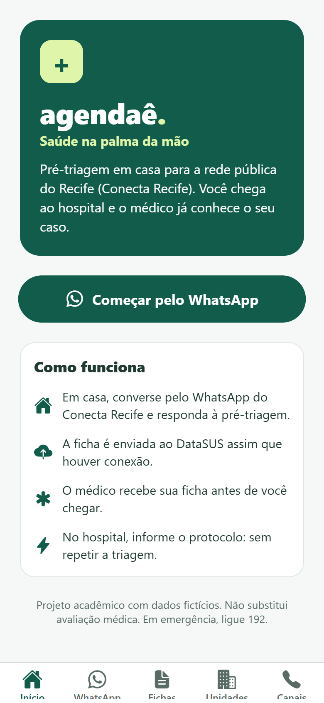 | 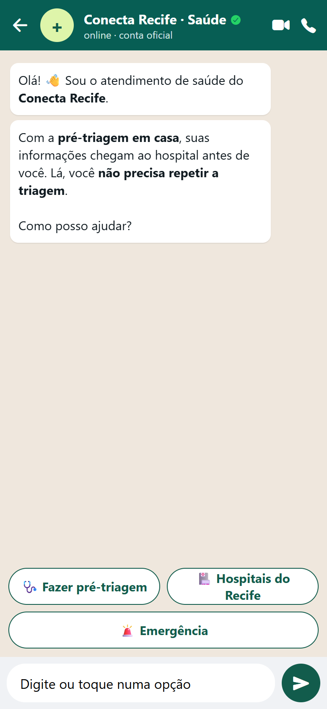 | 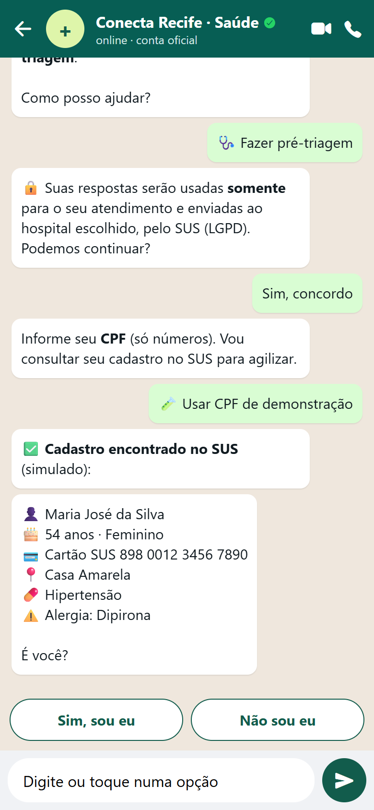 |
| Início (Fade + Pulse) | Tela do WhatsApp (tela cheia) | Cadastro SUS pelo CPF |
| 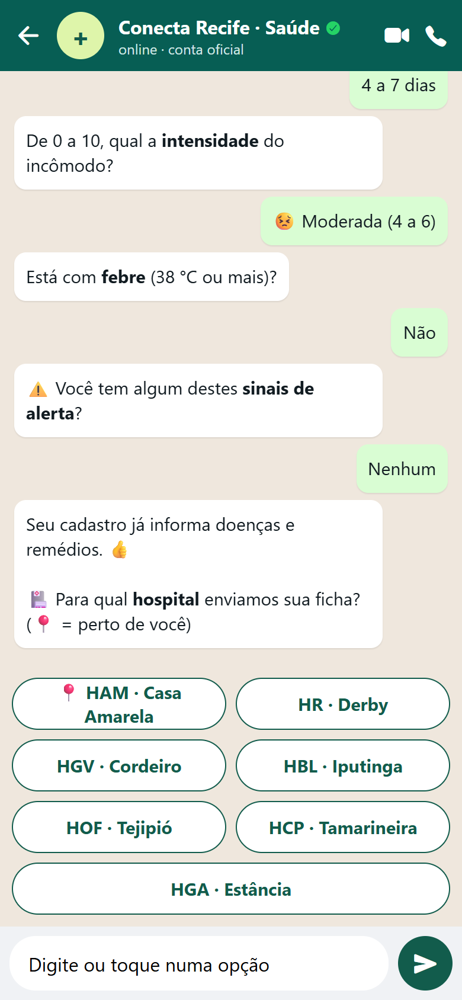 | 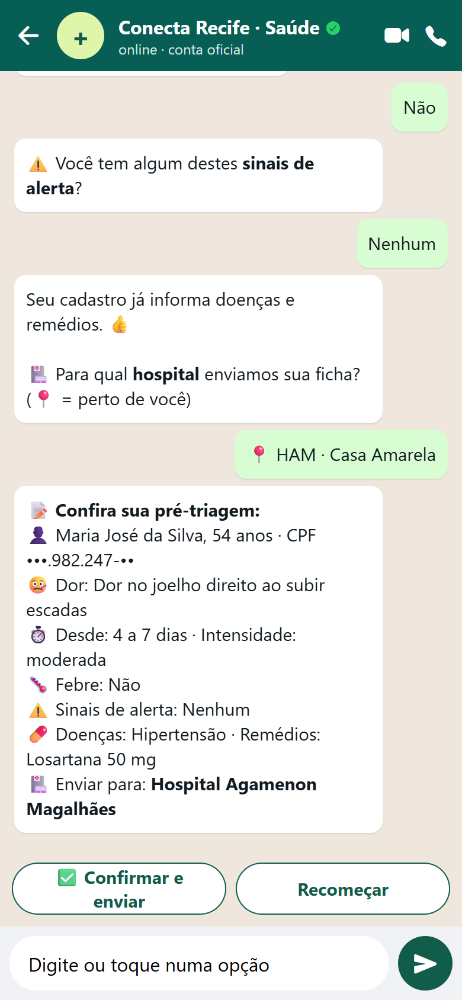 | 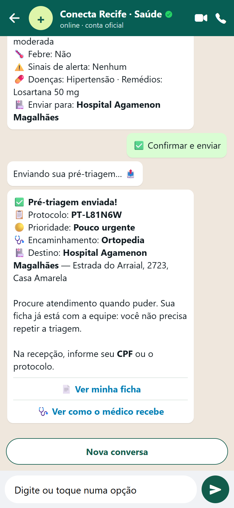 |
| Escolha do hospital (📍 = perto) | Resumo para confirmar | Protocolo enviado |
| 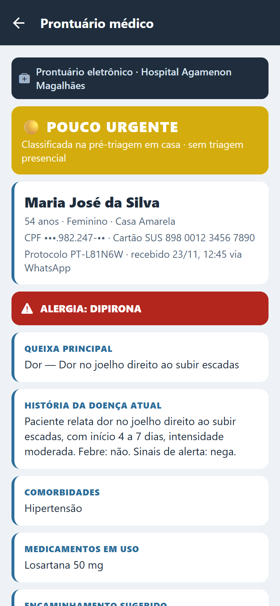 | 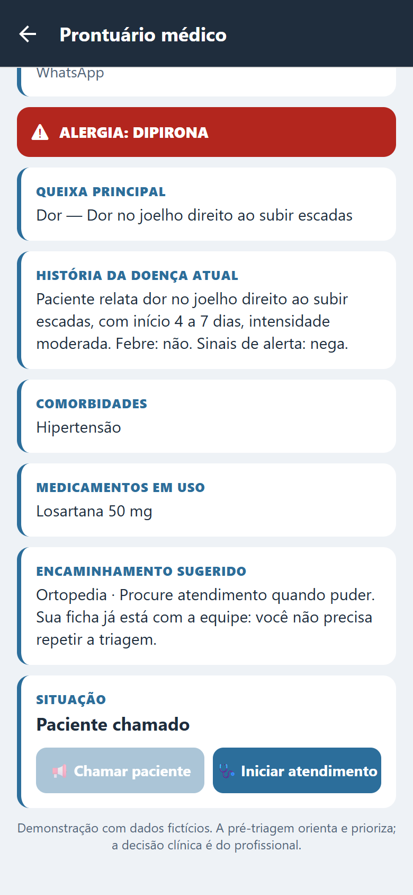 | 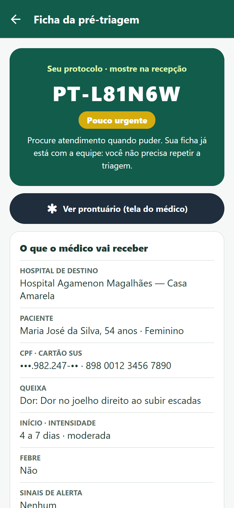 |
| Prontuário médico | Prontuário: encaminhamento e chamada | Ficha do cidadão (Stack) |
| 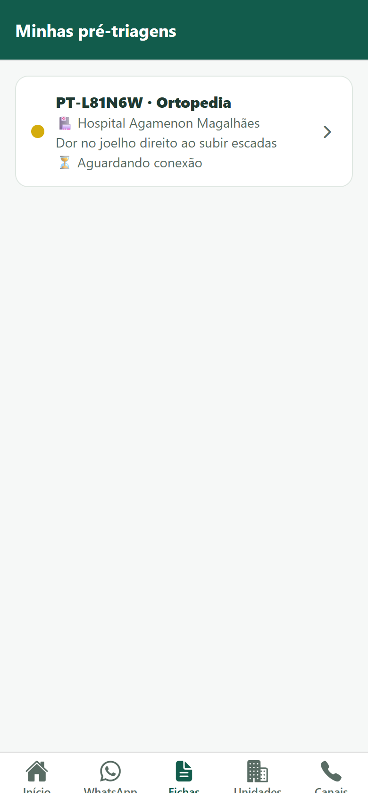 | 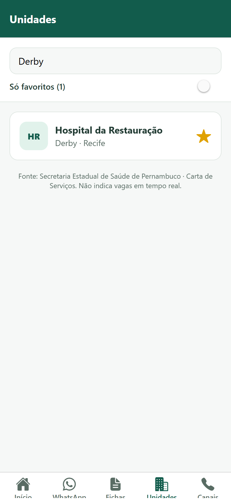 | 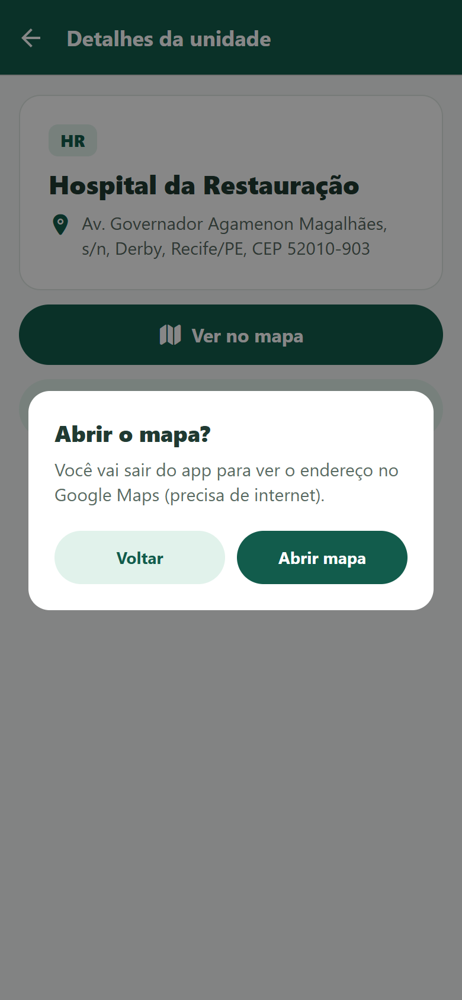 |
| Minhas fichas (FlatList) | Unidades: busca e favoritos | Detalhes + Modal |
| 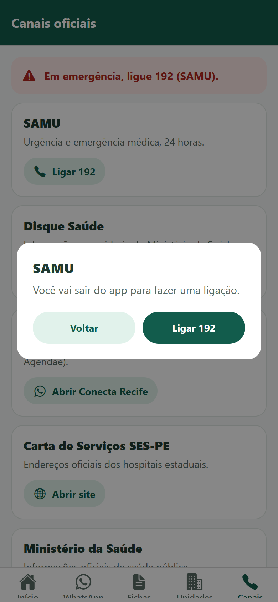 | 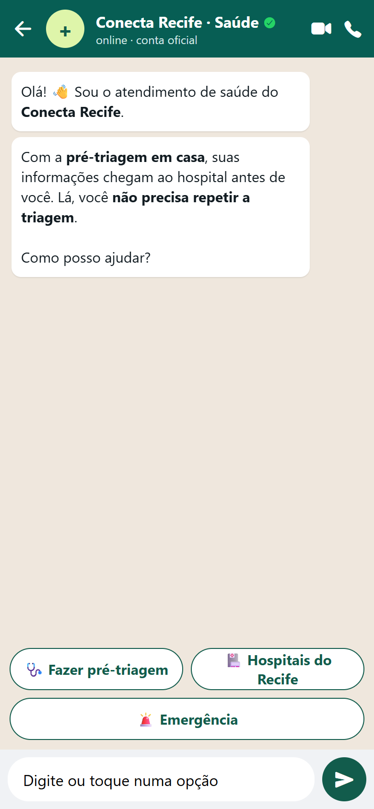 |  |
| Canais + Modal | Shake na mensagem vazia |  |

## PWA × React Native

| PWA original | Versão React Native |
| --- | --- |
| HTML, CSS e JavaScript no navegador | Componentes nativos (`View`, `Text`, `FlatList`, `TextInput`, `Modal`) |
| Navegação por âncoras (`#agendar`) | Expo Router com Stack e Bottom Tabs |
| Chat do WhatsApp dependente da API | Conversa roda no aparelho, também sem internet |
| `localStorage` | `AsyncStorage` |
| Animações CSS | API `Animated` (Fade, Pulse, Shake) |
| Pré-triagem por formulário | Pré-triagem guiada por botões, com CPF, histórico e hospital de destino |

## Dificuldades e soluções

| Dificuldade | Solução |
| --- | --- |
| Público com pouca internet | A conversa e as regras de triagem rodam no aparelho; a ficha fica numa fila e é enviada depois |
| Digitar é difícil para parte do público | Quase todas as respostas são botões; o CPF puxa os dados do cadastro |
| Favoritos e fichas compartilhados entre telas | Context API (`FavoritesProvider` e `TriagesProvider`) |
| A lista do chat não mostrava as últimas mensagens | `initialNumToRender` maior e rolagem automática ao fim |
| `*` do CPF mascarado virava negrito do WhatsApp | Máscara com `•` |
| App na web bloqueado pelo servidor (CORS) | Liberação de CORS apenas nas rotas públicas `/api/chat` e `/api/status` |

## Vídeo

`Video-Agendae-PWA-x-ReactNative.mp4` (2min30, enviado no Teams) mostra o PWA original e o app React Native com legendas. Roteiro para regravar com narração:

### Roteiro do vídeo (até 5 minutos)

1. **0:00–0:40** — Problema e proposta B2G: pré-triagem em casa pelo WhatsApp do Conecta Recife, sem repetir a triagem no hospital.
2. **0:40–1:20** — O PWA original no navegador (https://agendae-pwa.vercel.app): telas e o chat em `/zap`.
3. **1:20–3:30** — O app React Native no celular: Início (Fade e Pulse), WhatsApp com CPF de demonstração, cadastro, perguntas, hospital, resumo e protocolo; depois a ficha (Stack), o envio e a aba Fichas.
4. **3:30–4:20** — Unidades (busca, favoritos, detalhes e Modal), Canais (Modal do 192) e o Shake no chat.
5. **4:20–5:00** — Comparação PWA × React Native, os recursos usados e as dificuldades.

## Links

- Código-fonte: https://github.com/eusettee/agendae-pwa (pasta `mobile/`)
- PWA original: https://agendae-pwa.vercel.app
